<div align="center">

# 🔬 Stress-Granule Segmentation with Pseudo-Labels

### Label refinement · U-Net ablation · Statistical evaluation

**Group 7** · Prabhav Pradeep · Rahul Joseph Bejoy · Vedant P K


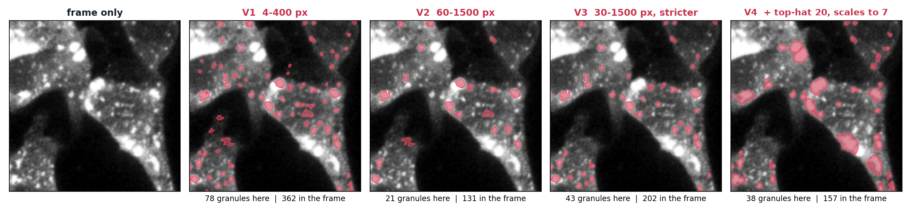

<sub><i>The same cells, labelled by each of the four versions of our automatic labeller (red = granule).</i></sub>

</div>

---

Stress granules are bright, dynamic puncta that form in cells under stress; their number and size
change within minutes. No manual masks exist at the scale needed to train a network, so we
**built an automatic labeller, refined it over four versions, trained five U-Net variants on its
labels, and tested everything against granules outlined by hand in a video no model ever saw.**

## 📑 Contents

| | Section | | Section |
|---|---|---|---|
| 1 | [Key results](#-key-results) | 7 | [Statistics and baseline](#-4-statistics-and-the-classical-baseline) |
| 2 | [Team and folders](#-team-and-where-everything-is) | 8 | [Conclusions](#-conclusions) |
| 3 | [Pipeline](#%EF%B8%8F-pipeline-at-a-glance) | 9 | [Deliverables](#-deliverables) |
| 4 | [Data](#-1-data-and-preprocessing) | 10 | [Reproduce](#%EF%B8%8F-how-to-reproduce) |
| 5 | [Labelling](#%EF%B8%8F-2-labelling) | 11 | [Timeline](#%EF%B8%8F-timeline) |
| 6 | [Architecture ablation](#-3-architecture-ablation) | 12 | [Repository map and rules](#%EF%B8%8F-repository-map) |

---

## 🏆 Key results

| | Result |
|---|---|
| **Better labels** | U-Net F1 on the hand-labelled tiles **0.34 → 0.52** (precision 0.23 → 0.49, recall kept at 0.71) |
| **Blob filter** | Deleting predicted blobs under **20 px** (chosen on validation data, no retraining): F1 **0.52 → 0.57**, false positives **75 → 56** |
| **Architecture** | **Skip connections** are the only significant component (5-fold F1 0.59 → 0.70, Holm *p* ≤ 0.01); attention and depthwise convolutions match U-Net within noise |
| **Efficiency** | Depthwise U-Net: **5× fewer parameters**, same accuracy (but not faster on our GPU) |
| **Ceiling** | With the filter, the networks **match the labeller they learned from** (F1 0.57 vs 0.56) and draw better outlines (Dice 0.71 vs 0.67) |
| **Baseline** | A Difference-of-Gaussians detector finds 79 % of granules but makes 714 false positives: **F1 0.22** |

> **Bottom line:** better labels and a simple, validated post-processing step improved every network
> more than any architectural change beyond skip connections.

---

## 👥 Team and where everything is

| Member | Roll no. | Part | Folder |
|---|---|---|---|
| **Prabhav Pradeep** | CH24BTECH11029 | Stage 1: preprocessing, pseudo-labels, tiling, grouped 5-fold split, Roboflow tiles | [`Prabhav_…_Data_Preparation/`][P1] |
| | | Stage 2: final labeller (V4), label versions V1–V4, hand-label packaging, size / perimeter / time analysis, final deck | [`Prabhav_…_Data_Labelling_Final_Submission/`][P2] |
| **Rahul Joseph Bejoy** | CH24BTECH11031 | Five-network ablation, training, hand-tile scoring, blob filter, loss curves | [`Rahul_…_Ablation_Study/`][RA] |
| **Vedant P K** | CH24BTECH11042 | Friedman / paired *t* / Holm tests, violin plots, DoG label-free baseline | [`Vedant_…_Statistics_and_Label_Free_Methods/`][VE] |

Every folder has its own `README.md` with its files, how to run the code, and its key numbers.

---

## 🗺️ Pipeline at a glance

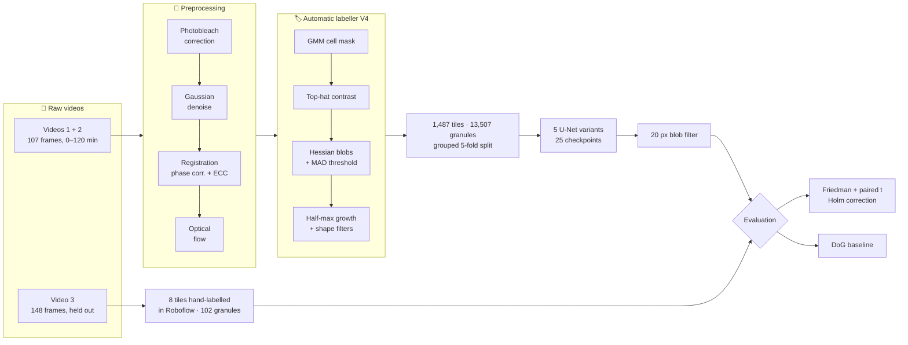

---

## 🎥 1. Data and preprocessing

| Video | Frames | Time | Role |
|---|---|---|---|
| Video 1 | 21 | 0–60 min | training pool |
| Video 2 | 86 | 60–120 min | training pool |
| Video 3 | 148 | — | **held out**: final test only |

All frames are 1024 × 1024 px, 8-bit. Each video is cleaned before labelling:

1. **Photobleaching correction.** Fit $\log L_t = a - \kappa t$ to each frame's foreground level and multiply frame *t* by $e^{\kappa t}$, but only if the signal decays ($\kappa > 0$), so a real biological rise is never dimmed.
2. **Denoising** with a Gaussian ($\sigma = 1$).
3. **Registration** to frame 0: phase correlation, refined by ECC with a rigid transform, chained frame to frame.
4. **Optical flow** (Farnebäck), whose magnitude helps separate moving cells from noise.

<table>
<tr>
<td width="50%">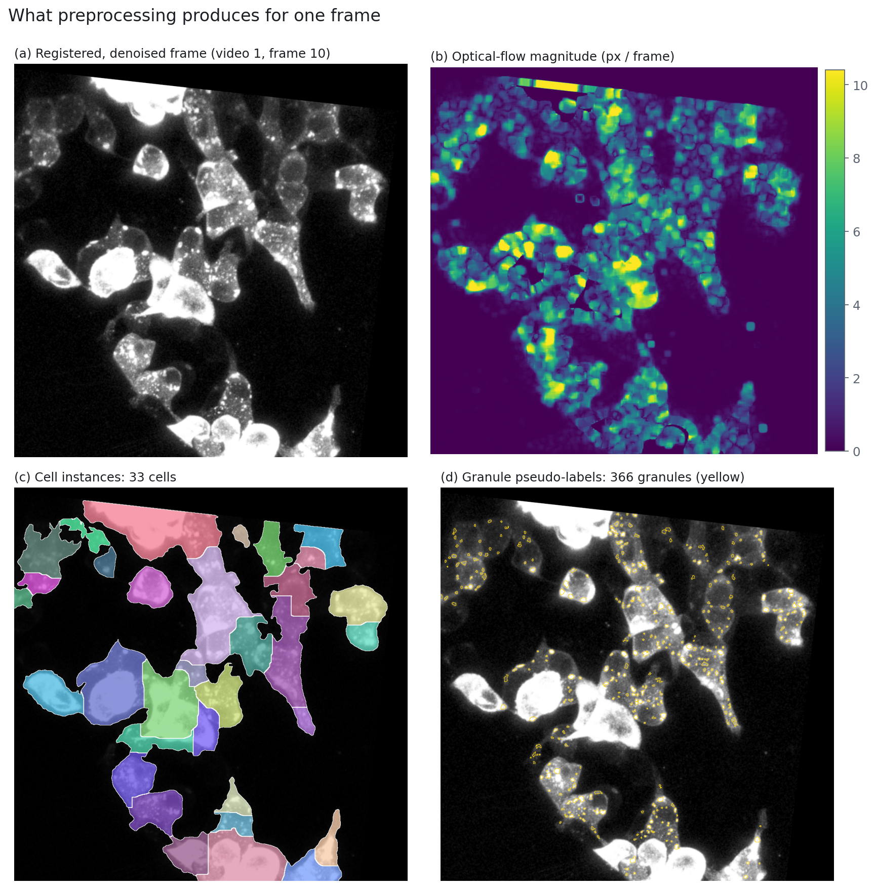<br><sub>Aligned frame, optical flow, cells and granules (video 1, frame 10).</sub></td>
<td width="50%">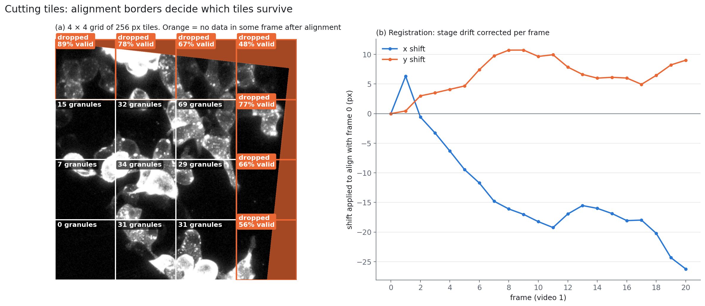<br><sub>The registered frame is cut into 256 px tiles.</sub></td>
</tr>
<tr>
<td>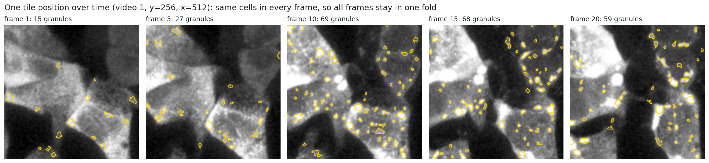<br><sub>One grid position across frames shows the same cells, so a random split would leak. Folds are grouped by position.</sub></td>
<td>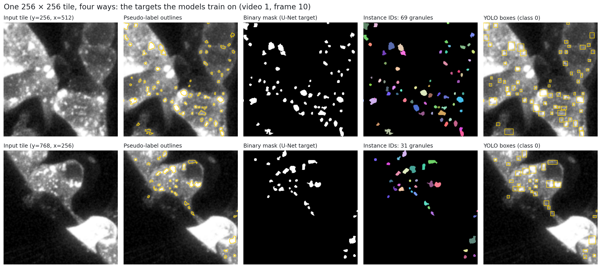<br><sub>Every tile comes with an image, a granule mask, granule and cell instances, and YOLO boxes.</sub></td>
</tr>
</table>

---

## 🏷️ 2. Labelling

### 2.1 Automatic labels for training, manual labels for testing

* **Training:** every granule in videos 1 + 2 is labelled **automatically** by a classical labeller. The final (V4) dataset has **1,487 tiles** and **13,507 granules**, in **5 folds grouped by grid position** (no position is ever in both train and test).
* **Testing:** 20 tiles of the held-out video 3 were uploaded to Roboflow, and **8 tiles (102 granules) were outlined by hand** with polygons. They are the fixed answer key for every label version and every network.

<div align="center">
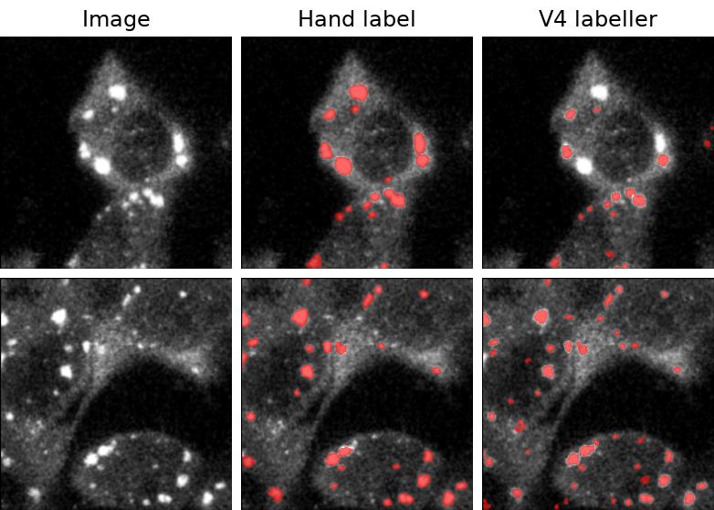<br>
<sub>Held-out video-3 tiles: the image, the manual (Roboflow) labels, and the automatic V4 labels.</sub>
</div>

### 2.2 How the labeller works

<details>
<summary><b>Click to expand the maths behind each step</b></summary>

**Cell mask.** Each pixel is described by $\mathbf{x} = (\sqrt{I}, \log(1 + D))$, where $D$ is the optical-flow magnitude. A three-component Gaussian mixture separates empty background, dark noisy pixels and cells:

$$P(\text{cell}\mid\mathbf{x}) = \frac{\pi_c\,\mathcal{N}(\mathbf{x};\boldsymbol\mu_c,\boldsymbol\Sigma_c)}{\sum_{j=1}^{3}\pi_j\,\mathcal{N}(\mathbf{x};\boldsymbol\mu_j,\boldsymbol\Sigma_j)}\cdot\frac{1}{1+e^{-(I-I_0)/0.005}}$$

The sigmoid gate stops motion alone from making a dark pixel a cell pixel.

**Top-hat contrast.** Cell brightness varies about 10×, so a global threshold fails. The background is the smoothed grey-scale opening with a disk $B_r$, and the score is a relative contrast:

$$b = G_{r/2} * (I_s \circ B_r), \qquad S = \frac{I_s - b}{b + 0.05}$$

The opening removes every bright structure the disk does not fit inside, so $r$ must be **wider than the largest granule**.

**Hessian blobs.** At a bright blob both Hessian eigenvalues are strongly negative; on a ridge such as a cell rim one is near zero. The scale-normalised response

$$\mathcal{B} = \max_\sigma\, \sigma^2 \max(0, -\lambda_1(\sigma))$$

peaks at blob radius ≈ 1.4σ.

**Seeds and growth.** Seeds are local maxima with $\mathcal{B}/(b + 0.05) > \mathrm{med} + k \cdot 1.4826 \cdot \mathrm{MAD}$ and $S \ge S_{\min}$; the MAD makes the threshold robust to the granules themselves. Each seed grows to half its peak height, and size and shape filters reject rims and over-exposed cells.

</details>

<div align="center">
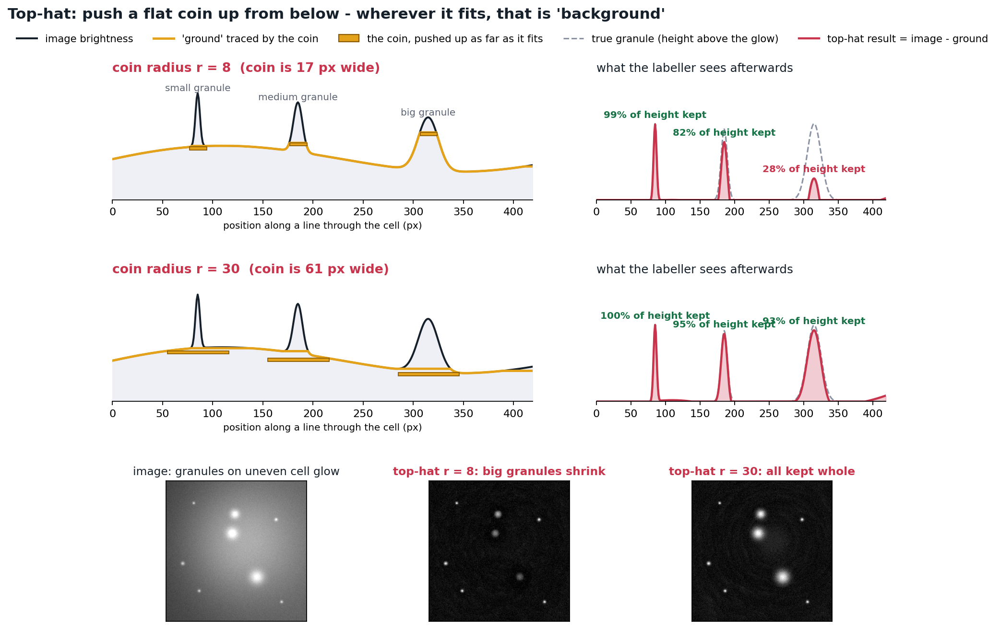<br>
<sub>Illustration of the top-hat filter on a synthetic profile: with a narrow window (r = 8, used in V1–V3) big granules lose most of their height; a wide window keeps them whole. V4 uses r = 20 px.</sub>
</div>

### 2.3 Four label versions, one fixed answer key

| Version | Change | Granules | U-Net P | U-Net R | U-Net F1 | Dice | Wrong |
|---|---|---:|---:|---:|---:|---:|---:|
| **V1** | every spot of 4–400 px | 22,283 | 0.23 | 0.73 | 0.34 | 0.53 | ~250 |
| **V2** | drop blobs < 60 px (too many false positives) | 7,998 | 0.49 | 0.38 | 0.37 | 0.52 | 41 |
| **V3** | back to 30 px, stricter brightness test | 13,039 | 0.43 | 0.66 | 0.46 | 0.55 | 88 |
| **V4** | top-hat 8 → 20 px, blob scales up to σ = 7 | 13,507 | 0.49 | 0.71 | 0.52 | **0.70** | 75 |
| **V4 + filter** | delete predicted blobs < 20 px | 13,507 | **0.56** | **0.71** | **0.57** | **0.71** | **56** |

<sub>U-Net trained on each version and scored on the 8 hand-labelled tiles (mean of 5 fold checkpoints).</sub>

<div align="center">
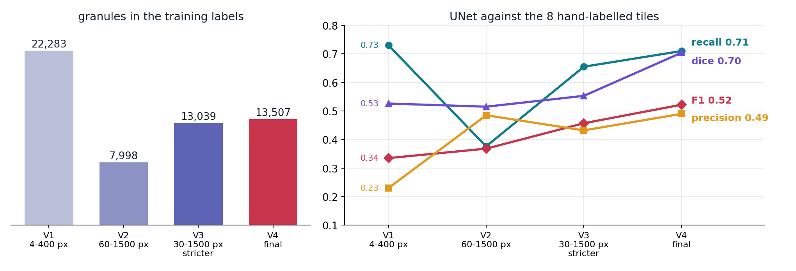<br>
<sub>Left: granules in the training labels. Right: U-Net against the hand labels. V4 keeps V1's recall at twice the precision.</sub>
</div>

* **Every network gained** from V2 to V4: NoSkip 0.36 → 0.48, U-Net 0.37 → 0.52, AttU-Net 0.35 → 0.54, DWU-Net 0.35 → 0.51, DWAttU-Net 0.36 → 0.51.
* **5-fold scores cannot compare label versions.** They measure how well a network copies its own labels: V1 scores highest there (0.71) yet is the worst on the hand tiles.

### 2.4 Where the remaining errors come from

<div align="center">
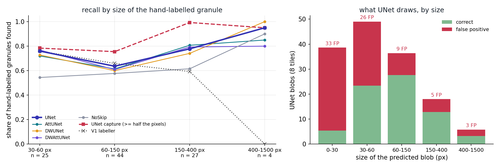<br>
<sub>Large granules are found (recall 0.80, 99 % captured for ≥ 150 px); <b>44 % of false positives are blobs under 30 px</b>, a size the labels never contain.</sub>
</div>

### 2.5 Granule size over time

<div align="center">
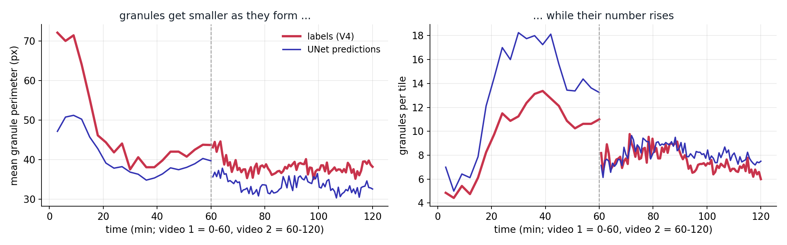<br>
<sub>In video 1, granules per tile rise from 6.2 to 13.3 while their mean perimeter falls from 62 to 34 px (<i>p</i> &lt; 0.001): many small new granules form. U-Net follows the trend but over-counts.</sub>
</div>

---

## 🧠 3. Architecture ablation

Five networks, base width 16, identical data, loss and training; they differ only in architecture.

| Model | What it tests | Parameters | Min / fold | Tiles / s |
|---|---|---:|---:|---:|
| NoSkip | plain encoder–decoder, no skip connections | 1,747,921 | 10.9 | 133 |
| UNet | + skip connections | 1,943,761 | 10.0 | 127 |
| AttUNet | + attention gates on the skips | 1,965,885 | 12.7 | 111 |
| DWUNet | depthwise-separable convolutions | 389,435 | 14.3 | 119 |
| DWAttUNet | depthwise + attention | 411,559 | 14.6 | 105 |

**Loss:** per-tile soft Dice + 0.5 × binary cross-entropy. **Training:** Adam 1e-3, batch 16, ≤ 30 epochs, early stopping (patience 6) on validation Dice; flips, 90° rotations and brightness / contrast jitter.
**Matching:** granules are connected components, matched one-to-one (Hungarian) at IoU ≥ 0.5.

<table>
<tr>
<td width="50%">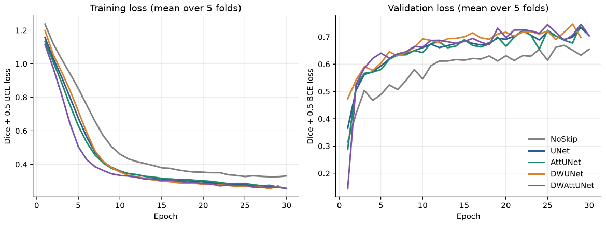<br><sub>Skip connections speed up convergence and lower the training loss.</sub></td>
<td width="50%">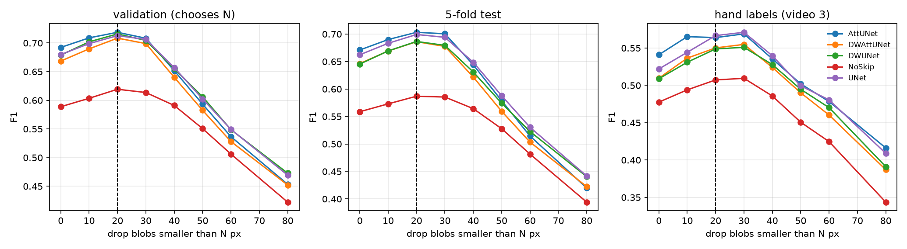<br><sub>Validation tiles alone choose the 20 px minimum blob size.</sub></td>
</tr>
</table>

| Model | 5-fold F1 (no filter) | 5-fold F1 (20 px filter) | Matched IoU | Hand-tile F1 (no filter → filter) |
|---|---|---|---|---|
| NoSkip | 0.559 ± 0.044 | 0.587 ± 0.043 | 0.716 | 0.478 → 0.507 |
| UNet | 0.662 ± 0.045 | 0.699 ± 0.039 | 0.824 | 0.522 → **0.567** |
| AttUNet | **0.671 ± 0.050** | **0.703 ± 0.047** | 0.827 | 0.541 → 0.564 |
| DWUNet | 0.645 ± 0.049 | 0.686 ± 0.045 | **0.833** | 0.509 → 0.549 |
| DWAttUNet | 0.646 ± 0.044 | 0.686 ± 0.048 | 0.820 | 0.510 → 0.550 |

<sub><b>Matched IoU</b> = mean IoU of the granules that were matched (so ≥ 0.5): it measures outline quality, not coverage.</sub>

<div align="center">
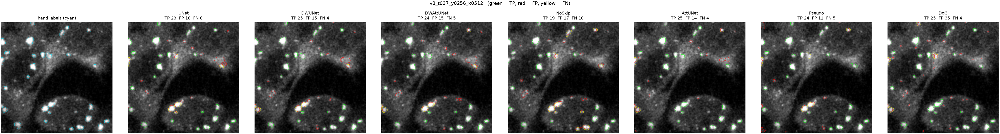<br>
<sub>Side by side on unseen hand-labelled tiles: green = correct, red = false positive, yellow = missed.</sub>
</div>

---

## 📊 4. Statistics and the classical baseline

Folds are the paired unit (each model has one score per fold). A **Friedman test** checks whether the five models differ at all; **paired *t*-tests with Holm correction** compare every pair. A Wilcoxon test cannot be used: with 5 folds its smallest possible *p* is 0.0625.

<div align="center">
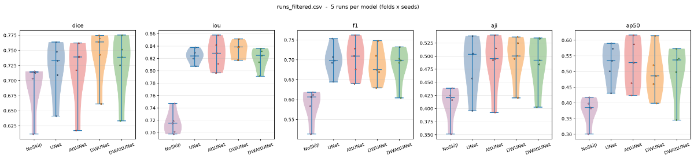<br>
<sub>Per-fold scores with the 20 px filter. NoSkip is clearly lowest on matched IoU, F1, AJI and AP50.</sub>
</div>

| Pair | ΔF1 | *p* (F1) | ΔIoU | *p* (IoU) | *p* (Dice) |
|---|---:|---:|---:|---:|---:|
| UNet vs NoSkip | +0.112 | **0.004** | +0.108 | **0.002** | 0.37 |
| AttUNet vs NoSkip | +0.116 | **0.002** | +0.111 | **0.001** | 0.37 |
| DWUNet vs NoSkip | +0.100 | **0.009** | +0.117 | **0.001** | **0.002** |
| DWAttUNet vs NoSkip | +0.099 | **0.001** | +0.103 | **0.001** | 0.21 |
| UNet vs AttUNet / DWUNet | ≤ 0.013 | ≥ 0.87 | ≤ 0.009 | ≥ 0.52 | ≥ 0.49 |

<sub>Holm-adjusted; Friedman <i>p</i> = 0.007 (F1) and 0.011 (IoU). Skip connections mainly help to separate and outline granules, not to cover more pixels. On the 8 hand tiles no difference is significant (<i>p</i><sub>Holm</sub> = 1.00): too few tiles.</sub>

### Every method on the same 8 hand-labelled tiles

| Method | F1 | Precision | Recall | Dice | False positives |
|---|---:|---:|---:|---:|---:|
| UNet + 20 px filter | **0.567** | 0.563 | 0.706 | **0.705** | 55.8 |
| AttUNet + 20 px filter | 0.564 | 0.568 | 0.690 | 0.697 | 53.6 |
| V4 labeller (the labels themselves) | 0.561 | **0.611** | 0.647 | 0.674 | 42 |
| UNet, no filter | 0.522 | 0.490 | 0.710 | 0.704 | 75.4 |
| NoSkip + 20 px filter | 0.507 | 0.509 | 0.578 | 0.688 | 57.0 |
| DoG baseline (no training) | 0.224 | 0.102 | **0.794** | 0.502 | 714 |

<sub>F1 and Dice: mean over tiles; precision and recall: from counts summed over tiles.</sub>

---

## 🎯 Conclusions

1. **Labels are the bottleneck.** The networks reach, but do not exceed, the detection accuracy of the labeller they learned from, so improving the labels (V1 → V4) helped more than anything else.
2. **One validated post-processing step is worth more than a heavier network.** The 20 px blob filter lifted every model.
3. **Skip connections are necessary; attention and depthwise convolutions are optional.** The depthwise model gives the same accuracy with 5× fewer parameters.
4. **Limits:** one seed, 8 hand-labelled tiles, validation frames that share grid positions with training frames, and touching granules that get merged. Next steps: watershed splitting and fine-tuning on a few hand-labelled tiles.

---

## 📦 Deliverables

| What | Where |
|---|---|
| 🖥️ Final presentation (35 slides, backup tables) | [`presentation/`][P2pres] · LaTeX source in [`slides/`][P2slides] |
| 🖥️ Stage-1 presentation | `presentation/Group7_Final_Presentation_Phase1.pdf` in each member's Stage-1 folder |
| 📄 IEEE report — data labelling section | [`docs/IEEE_Report_DataLabelling_Section/`][P2docs] |
| 🧾 Results behind every slide | [Prabhav][P2res] · [Rahul][RAres] · [Vedant][VEres] |
| 🗂️ Raw videos, labelled data, full submission bundle | shared through Google Drive (too large for this repository) |

---

## ⚙️ How to reproduce

```bash
git lfs install            # once, so PDFs, zips and .npz files download as real files
git clone https://github.com/Prabhav-Pradeep/Group7-Stress-Granule-Detection.git
```

| Step | Who | Run |
|---|---|---|
| 1. Labels and dataset | Prabhav | `code/DataLabelling_V4_Final_5fold_Dataset_and_Roboflow_Tiles.ipynb` in Colab (CPU), with the three videos in `MyDrive/SGTracking/content` |
| 2. Package labelled data | Prabhav | `python code/build_labelled_data_package.py --drive … --tiles … --coco …` |
| 3. Train and score the 5 networks | Rahul | `python code/rahul_5fold_ablation.py`, then `code/score_video3.py` on the hand tiles |
| 4. Blob filter | Rahul / Prabhav | `code/analysis/blob_filter_eval.py` (in Prabhav's Stage-2 folder) |
| 5. Statistics and DoG | Vedant | `python code/vedant_stats.py --file runs_filtered.csv --mode folds`, and `code/dog_label_free_method.py` |

Each step's exact arguments are in that member's README.

---

## 🗓️ Timeline

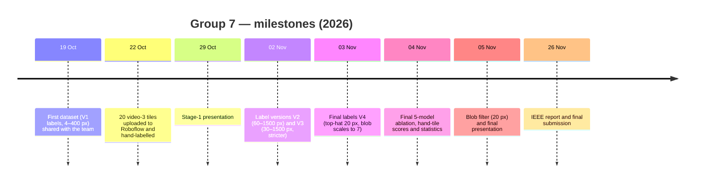

---

## 🗃️ Repository map

```text
Group7-Stress-Granule-Detection/
├── README.md                     ← you are here
├── SUBMISSION_PROTOCOL.md        how members commit (one folder each, labelled commits)
├── Prabhav_Pradeep_CH24BTECH11029_Data_Preparation/            Stage 1
│   ├── code/                     notebook + sgtrack/ (preprocess, pseudolabel, pipeline, share)
│   └── figures/                  preprocessing and dataset examples
├── Prabhav_Pradeep_CH24BTECH11029_Data_Labelling_Final_Submission/   Stage 2
│   ├── code/                     final V4 notebook, packaging script, analysis/, earlier_versions/
│   ├── results/                  every label version, blob filter, size and perimeter tables
│   ├── presentation/  slides/    final deck (PDF) and its LaTeX source
│   └── docs/                     IEEE report: data labelling section
├── Rahul_Joseph_Bejoy_CH24BTECH11031_Ablation_Study/
│   ├── code/                     5-fold training, video-3 scoring, loss-curve plot
│   ├── results/final/            final 5-fold runs, histories, hand-tile scores
│   └── results/…                 earlier label rounds
└── Vedant_PK_CH24BTECH11042_Statistics_and_Label_Free_Methods/
    ├── code/                     statistics (vedant_stats.py, vedant_all.py), DoG baseline
    └── results/final/            final tests, with and without the 20 px filter
```

### Rules we follow

* **One folder per member**, holding only that member's work. Every commit is labelled `[Name | Part] Add/Update: …`, as described in [`SUBMISSION_PROTOCOL.md`](SUBMISSION_PROTOCOL.md), so `git log` shows who did what.
* **Large files** (`.zip`, `.npz`, `.pdf`, `.pptx`, weights) are stored with [Git LFS](https://git-lfs.com). Run `git lfs install` before cloning.
* **No sensitive content**: no keys, tokens or personal data in code, notebooks or outputs.

<div align="center">

---

<sub>Group 7 · Stress-granule segmentation · 2026</sub>

</div>

[P1]: Prabhav_Pradeep_CH24BTECH11029_Data_Preparation/
[P2]: Prabhav_Pradeep_CH24BTECH11029_Data_Labelling_Final_Submission/
[P2pres]: Prabhav_Pradeep_CH24BTECH11029_Data_Labelling_Final_Submission/presentation/
[P2slides]: Prabhav_Pradeep_CH24BTECH11029_Data_Labelling_Final_Submission/slides/
[P2docs]: Prabhav_Pradeep_CH24BTECH11029_Data_Labelling_Final_Submission/docs/IEEE_Report_DataLabelling_Section/
[P2res]: Prabhav_Pradeep_CH24BTECH11029_Data_Labelling_Final_Submission/results/
[RA]: Rahul_Joseph_Bejoy_CH24BTECH11031_Ablation_Study/
[RAres]: Rahul_Joseph_Bejoy_CH24BTECH11031_Ablation_Study/results/final/
[VE]: Vedant_PK_CH24BTECH11042_Statistics_and_Label_Free_Methods/
[VEres]: Vedant_PK_CH24BTECH11042_Statistics_and_Label_Free_Methods/results/final/
